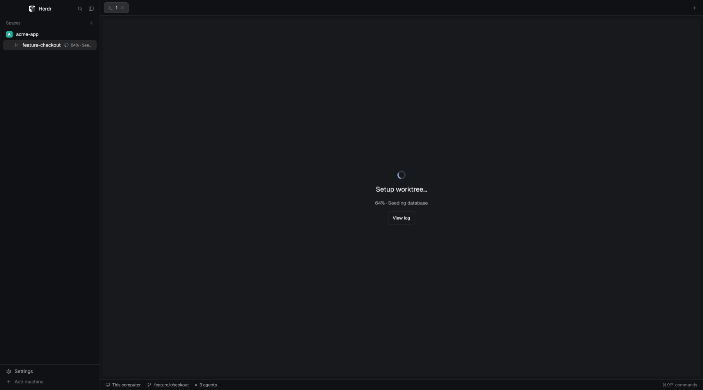

# Worktree bootstrap

Herdr's main layout with a worktree lifecycle: a new worktree gets its local
files copied and its setup scripts run while the sidebar and its first tab show
the progress, removal runs teardown scripts first, and a dialog edits those
scripts per repository. Nothing to install besides Herdr: sh and Git.

## What you see

- **Sidebar:** Herdr's spaces list. A worktree row being set up or torn down
  shows a native spinner (12 px, accent), then `NN% · step` in 11 px muted text,
  truncated; red (`blocked`) on failure.
- **First tab of a worktree being set up:** instead of the terminal, a centered
  24 px accent spinner, “Setup worktree…” at 18 px semibold, the step at 13 px
  muted, and a **View log** button (plus **Retry setup** after a failure, with
  the title in red). Other tabs and spaces stay usable.
- **Remove worktree dialog:** the teardown step with a spinner, and a branch
  choice that cycles keep / delete safely / FORCE delete, which asks for the
  exact branch name before deleting.
- **Worktree scripts… (main checkout's right-click menu):** a 760×640 dialog with
  three sections, “When a worktree is created”, “Before a worktree is removed”,
  “After a worktree is removed”. Each has rows of name, command (terminal font)
  and timeout in seconds, ↑ and × buttons, and “+ Add command”. Below them,
  “Files to copy into new worktrees” is a textarea, then **Cancel** / **Save**.

## How it behaves

- New worktree (space menu or + menu): the checkout is created in
  `~/.herdr/worktrees/<repo>/<branch>`, the copy list's Git-ignored files are
  copied in one transaction, then the `on_created` commands run as argv arrays,
  never through a shell. Hooks can report their own step and percentage with
  `"$HERDR_PROGRESS_COMMAND" --step … --percent …`.
- The job runs in a herdr-core terminal, so it survives the app closing; the
  sidebar polls only running jobs, once a second.
- The first terminal is a gate: no shell until setup succeeds. Keystrokes typed
  meanwhile are discarded, then the shell (or chosen agent) starts.
- A failure keeps the checkout, shows the error and allows **Retry setup**, which
  uses the configuration as it is now.
- Removal: `before_remove` runs first. If it fails, or the checkout changed or
  became dirty, nothing is removed. Then Git removes the checkout,
  `after_remove` runs in the main checkout, and the branch is deleted if that
  was chosen. Protected, default and in-use branches are never deleted.
- Scripts dialog: **Save** (⌘S) writes `.herdr/worktree-setup.json` and
  `.herdr/worktree-copy.list` in the main checkout, only what changed, and
  refuses if a file was edited elsewhere since the dialog opened. A command's
  script path (`./setup.sh`, `bash setup.sh`) is relative to the repository:
  taken from the worktree, else from the main checkout.

## Built from

- Layout `worktree-bootstrap`: a clone of `main` whose mods are personal copies
  (`bootstrap-spaces`, `bootstrap-tabs`, `bootstrap-menu`, `bootstrap-new-menu`,
  `bootstrap-chrome`, `bootstrap-pane`, `worktree-bootstrap`). Its active-tab
  block sits in a stack `bootstrap-content` with children `main` (the terminal
  block) and `bootstrap-setup` (mod `worktree-bootstrap-setup`), switched with
  `layout.select`.
- `worktree-bootstrap-scripts`: the scripts dialog, opened with `openOverlay`
  from `bootstrap-menu` when the space is a main checkout.
- Every mod carries copies of `api.js` (jobs, Git, shared state under
  `worktree-bootstrap.jobs`), `engine.js` (configuration rules, command-line
  splitting) and `worker.js` (the sh worker's source).
- herdr: `exec`, `hc` (`run --bg --outlive-parent`), `readTextFile`,
  `writeTextFile`, `shared`/`setShared`, `spaces`, `panes`, `layout`, `run`
  (`space.new` with the gate argv, `space.select`, `space.close`,
  `layout.select`), `openOverlay`, `notify`. Spinners use `svg(...).spin(900)`.
- Programs: `git` and `sh`. The mod writes `worker.sh` to the app's
  `data/worktree-bootstrap/runtime/` (or `~/.local/share/...` on an SSH machine).

## Watch out

- A mod can't import another mod's code: shared modules are copied into each.
- Install `mod.json` before `main.js`: a folder seen without it gets docked.
- `exec` has a 30 s limit: anything longer runs in an `hc run --bg` terminal.
- Jobs started outside these menus (plain `git worktree`) run no hooks.
- Built against Herdr app 0.1.12's native mods; newer versions may need a rebuild.
- SSH machines are supported but not yet qualified on a real remote host.

## Done when

- Right-clicking a main checkout shows **Worktree scripts…**; a linked worktree
  doesn't. Saving writes the JSON and copy list, and they reload unchanged.
- Creating a worktree copies `.env`, shows the spinner and step in the sidebar
  and the setup screen in its first tab only, then opens a shell.
- A failing hook keeps the checkout; **Retry setup** succeeds once it is fixed.
- A failing `before_remove` keeps the checkout; a successful removal runs
  `after_remove` in the main checkout.
- `node --test tests/*.test.mjs` passes, and `herdr-app check` passes for every mod.
